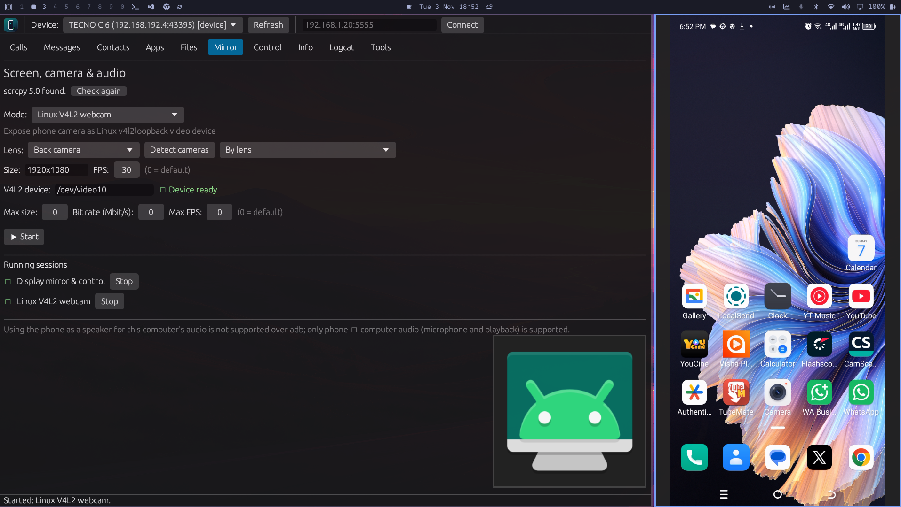

# ADB Phone Manager

ADB Phone Manager is a desktop application for browsing and managing an Android
device through Android Debug Bridge (ADB). It is written in Rust and uses
[egui](https://github.com/emilk/egui) for its graphical interface. Device
operations run in the background so the interface remains responsive.



## Features

- **Calls:** view recent call history, place calls, answer ringing calls, and
  reject or hang up calls.
- **Messages:** browse and filter SMS messages, open message details, and copy
  message content.
- **Contacts:** browse, filter, and copy contacts and phone numbers.
- **Apps:** search installed packages, launch or force-stop apps, view package
  details and permissions, and uninstall apps. System apps are removed for the
  primary Android user only; they remain on the system image.
- **Files:** browse device storage, create folders, upload and download files,
  open downloaded files with the desktop's default application, and delete
  remote files or folders.
- **Mirror:** start and manage [scrcpy](https://github.com/Genymobile/scrcpy)
  sessions for screen mirroring and control, camera preview, device audio,
  microphone forwarding, or Linux V4L2 webcam output. Configure recording,
  resolution, bit rate, frame rate, camera lens, and other supported options.
- **Control:** use navigation and media keys, adjust brightness and volume,
  type text, open a URL on the phone, change supported quick settings, capture
  screenshots, record the screen, preview a remote camera, and trigger power
  actions.
- **Info:** inspect device information, memory, and storage usage.
- **Logcat:** stream and filter Android logs by priority.
- **Tools:** connect or pair over wireless ADB, discover wireless debugging
  services, install APK files (including multiple APKs), upload files, export
  contacts/messages/call history, and run commands in an interactive ADB
  shell.

Some Android operations depend on the device manufacturer, Android version,
permissions, and available system services. A feature being visible does not
guarantee that every device supports it.

## Requirements

- Android device with **USB debugging** enabled, or an Android device reachable
  over wireless debugging.
- `adb` from Android SDK Platform-Tools.
- Rust and Cargo (Rust **1.82 or newer**) to build from source.
- `scrcpy` for the Mirror tab. Most mirroring modes require a recent scrcpy
  release; camera, audio, microphone, and webcam features require scrcpy 2.0 or
  newer.
- On Linux, **V4L2 loopback** is additionally required for the Linux webcam
  mode. This mode is unavailable on other operating systems.

ADB Phone Manager searches `PATH` and common Android SDK locations, including
`ANDROID_HOME` and `ANDROID_SDK_ROOT`. If the tools are installed in a
non-standard location, add their directories to `PATH` or set the appropriate
SDK environment variable before launching the application. `adb` is usually
in the SDK's `platform-tools` directory.

## Build and run

From the project directory:

```sh
cargo run
```

For an optimized build:

```sh
cargo build --release
./target/release/adb-phone-manager
```

The application starts watching for connected devices. On the first connection
to a phone, unlock it and accept the Android **Allow USB debugging?** prompt.
Select an authorized device from the device picker. Use **Refresh** if you
need to rescan devices.

To connect over a network, use the **Tools** tab to enable TCP/IP mode for a
USB-connected device, or pair using the pairing address and code from Android's
Wireless debugging settings. Both devices must be able to reach each other on
the network. Wireless debugging and pairing behavior varies by Android version.

## Linux installation

The project includes a per-user installer that builds the release binary and
installs it with a desktop entry and application icons:

```sh
./packaging/install-linux.sh
```

The installer places the executable in `${XDG_BIN_HOME:-$HOME/.local/bin}` and
desktop integration files under `${XDG_DATA_HOME:-$HOME/.local/share}`. Ensure
the binary directory is on `PATH` to launch it from a terminal. To run without
installing, use the release command shown above.

### Optional Linux V4L2 webcam setup

The webcam mode uses the `v4l2loopback` kernel module. On Arch Linux, install
the module package and load a loopback device, for example:

```sh
sudo pacman -S --needed dkms v4l2loopback-dkms
sudo modprobe v4l2loopback video_nr=10 card_label="PhoneWebcam" exclusive_caps=1
```

Select **Linux V4L2 webcam** in the Mirror tab and set the V4L2 device to match
the module device (for the example above, `/dev/video10`). A media application
that supports V4L2 can then select the virtual camera. The module may need to
be loaded again after reboot.

## Using the application

1. Connect and authorize a phone with ADB.
2. Select the intended device in the toolbar.
3. Open a tab and use its controls. Data lists have filters and configurable
   limits where applicable.
4. For transfers, browse to a remote directory in **Files**, or use the upload
   tools to choose a destination folder.
5. To export personal data, use **Tools → Data Export** and choose a local
   destination file.
6. To launch a mirror/camera/audio session, make sure scrcpy is installed and
   recognized, select the desired mode, then press **Start**. Stop sessions
   from the **Running sessions** list.

Screenshots and downloaded files are saved in the application's downloads
location. The status bar reports operation results and errors.

## Privacy and permissions

ADB Phone Manager communicates with Android through the local `adb` executable;
it does not require a separate phone companion app. It requests phone data only
when the corresponding view or action is used. Contacts, SMS, and call history
are sensitive data: exports are written to the local path you select. Treat
interactive shell commands and device-management actions as powerful; they run
with the access granted to ADB on the selected device.

The app does not bypass Android's authorization prompt. Revoke a computer's
debugging authorization from the phone's Developer options when you no longer
trust that computer. Avoid enabling wireless debugging on untrusted networks
and disable it when it is no longer needed.

## Troubleshooting

### No device appears

- Check the USB cable and connection mode.
- Enable USB debugging in Android Developer options and accept the authorization
  prompt on the phone.
- Check that `adb` is installed and available to the app. You can inspect the
  connection from a terminal with `adb devices -l`.
- On Linux, some devices require appropriate USB permissions or udev rules.
- Use **Refresh** after changing the connection or authorization state.

### `adb` or `scrcpy` cannot be run

Install Android SDK Platform-Tools (`adb`) and/or scrcpy, then ensure their
binary directories are on `PATH`. If the Android SDK is in a non-standard
location, set `ANDROID_HOME` or `ANDROID_SDK_ROOT` before starting the app.
The Mirror tab needs scrcpy independently of ADB; ordinary device browsing and
management do not require scrcpy.

### Mirror mode is disabled or fails to start

Check the scrcpy version reported on the Mirror tab and ensure it meets the
minimum shown for the selected mode. Confirm that a ready, authorized device is
selected. Camera, audio, and microphone support can also depend on Android
version and device capabilities.

### Webcam mode does not produce video

This mode is Linux-only. Confirm that `v4l2loopback` is loaded, that its device
number matches the Mirror tab setting, and that your media application supports
V4L2. The loopback module may require elevated privileges to install or load.

### A control or data query is unavailable

Android versions and vendors may limit telephony, permission, power, network,
or system-setting operations. Some features require the phone to be unlocked,
and certain commands may not be available on non-privileged ADB shells.

## Development

Run the test suite and lint all targets/features with:

```sh
cargo test
cargo clippy --all-targets --all-features -- -D warnings
```

Format Rust code with:

```sh
cargo fmt
```

## License

No license file is currently included in this repository. Check with the
project maintainers before redistributing the project or its assets.
